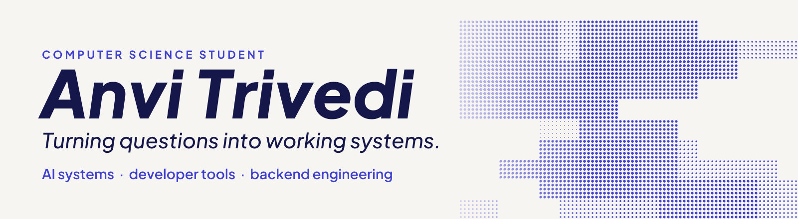
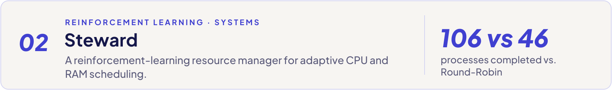
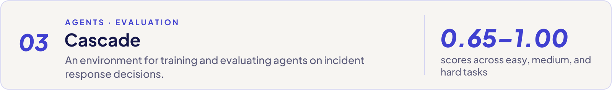
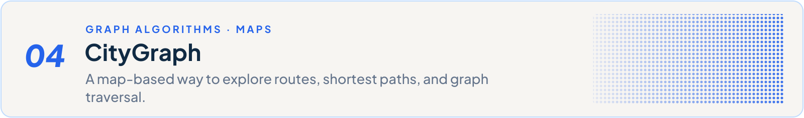
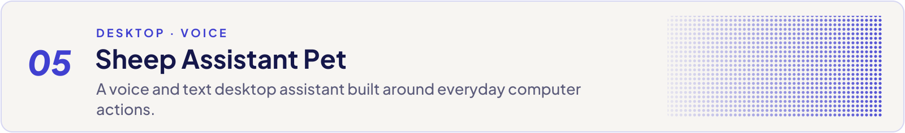

<a href="https://github.com/atconeyisland">
  <picture>
    <source media="(prefers-color-scheme: dark)" srcset="assets/banner-dark.svg">
    
  </picture>
</a>

  <a href="https://www.linkedin.com/in/YOUR-LINKEDIN-URL">LinkedIn</a> &nbsp;·&nbsp;
  <a href="mailto:YOUR-EMAIL">Email</a>

I build things when I run into a problem that should be easier to solve.

That usually means turning a question into a working system: can an agent remember without making things up? Can an operating system learn better scheduling decisions? Can graph algorithms feel intuitive on a real map? Can incident response be tested before production is on fire?

My projects sit around those questions, with a focus on **AI systems, developer tools, backend engineering, and practical interfaces**.

<picture>
  <source media="(prefers-color-scheme: dark)" srcset="assets/divider-dark.svg">
  
</picture>

## What I work with

<picture>
  <source media="(prefers-color-scheme: dark)" srcset="assets/skills-dark.svg">
  
</picture>

<picture>
  <source media="(prefers-color-scheme: dark)" srcset="assets/divider-dark.svg">
  
</picture>

## A few things I have built

<a href="https://github.com/atconeyisland/rfp-memory-agent"><picture>
  <source media="(prefers-color-scheme: dark)" srcset="assets/card-rfp-memory-agent-dark.svg">
  
</picture></a>

<a href="https://github.com/atconeyisland/Steward"><picture>
  <source media="(prefers-color-scheme: dark)" srcset="assets/card-steward-dark.svg">
  
</picture></a>

<a href="https://github.com/atconeyisland/Cascade"><picture>
  <source media="(prefers-color-scheme: dark)" srcset="assets/card-cascade-dark.svg">
  
</picture></a>

<a href="https://github.com/atconeyisland/CityGraph"><picture>
  <source media="(prefers-color-scheme: dark)" srcset="assets/card-citygraph-dark.svg">
  
</picture></a>

<a href="https://github.com/atconeyisland/sheep-assistant-pet"><picture>
  <source media="(prefers-color-scheme: dark)" srcset="assets/card-sheep-assistant-pet-dark.svg">
  
</picture></a>

I am still learning, still testing ideas, and usually more interested in making a system work than making it sound impressive.
